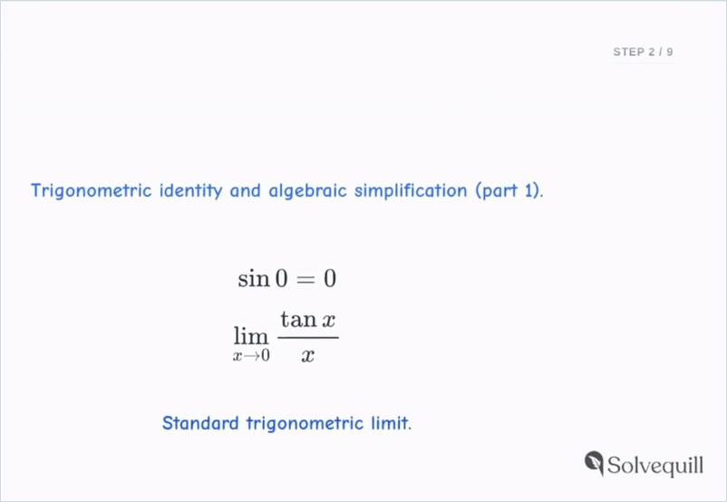
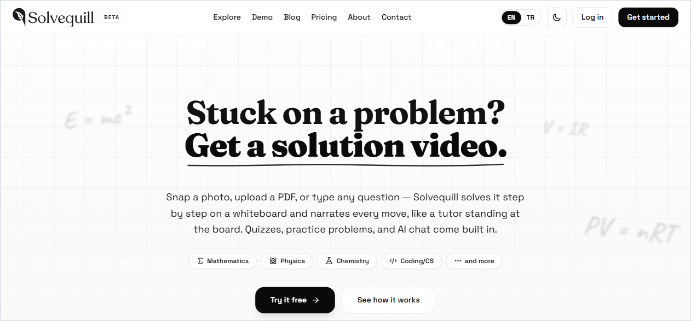
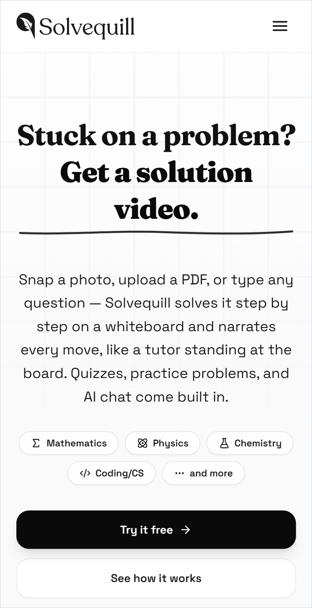

# Solvequill

Solvequill turns a homework question into a short narrated whiteboard video lesson.

**Live in beta at [www.solvequill.com](https://www.solvequill.com)** · [Product tour](https://www.solvequill.com/demo) · [Shared lessons](https://www.solvequill.com/explore)

Founder & developer: **Mirza İşi**, a Computer Engineering student at Izmir University of Economics in Izmir, Turkey.

  

A clip from the product tour. In a lesson, a voice explains each line as it is written.

## At a glance

- **Subjects:** mathematics, physics, chemistry and coding, such as algebra through calculus, mechanics and circuits, stoichiometry and reactions, and code to trace, debug or explain. Other questions are declined rather than guessed at.
- **Languages:** English and Turkish, each fully narrated. Built Turkish-first, with an EN/TR switch on the website.
- **For:** students, teachers and curious learners.
- **Beta:** new accounts start with free videos, study tools included, and no card is needed. Payments are closed during the beta; paid plans are on the way.
- **Development:** 4,500+ commits since 1 April 2026, in a private repository.

## What it does

1. **Send the question.** Type it, or upload a photo, a screenshot, a PDF, or a text or code file. Solvequill reads the text, formulas and diagrams, handwriting included, and redraws a question's diagram on the board where it can.
2. **Get the lesson.** The problem is solved step by step on a whiteboard while a voice explains each move, like a tutor at the board, for that exact question rather than the topic in general. A video takes a few minutes to make, watching usually starts before it has finished rendering, and most run one to six minutes.
3. **Keep studying.** Every lesson comes with a summary, a quiz, practice problems on the same idea (at a chosen difficulty, with hints, worked answers and a check of your answer), and a chat about that solution.

Lessons can be paused, replayed, downloaded, shared by link and found again in your history. Every solution goes through automated checks while it is being solved; answers are still not always right, and a video can be reported.

  
  

The home page on a laptop and on a phone.

## Built with

- **Monorepo:** TypeScript and Node.js, with pnpm workspaces and Turborepo
- **Web:** Next.js, React, Tailwind CSS, KaTeX
- **API and data:** Fastify, Prisma, Zod, PostgreSQL on Neon
- **Video:** Remotion
- **AI:** OpenAI API, for solving and for the spoken narration
- **Python service:** FastAPI, SymPy, Pint
- **Infrastructure:** Google Cloud Run, Cloud Build and Cloud Tasks, Cloudflare R2, Firebase Hosting, Docker, Resend
- **Tests:** Vitest, Playwright, pytest

## In progress

Not released yet; in design or being built.

- **Learn a topic:** name a topic or upload course material, and get a longer lesson that teaches it first, then works through examples.
- **Several questions in one upload:** each question on a photo or PDF that the student keeps becomes its own lesson.
- **Richer figures and a fuller board:** more kinds of diagrams, annotated as the lesson goes, photographed figures included, on a board that uses more of its space (diagrams on the board are already live).
- **More subjects:** biology, statistics and probability, engineering courses, computer-science theory, and business and economics, plus deeper university-level coverage of the four live subjects.
- **More natural narration and pacing,** shaped by a study of how well-regarded teachers explain on video, in English and Turkish.

## Links

[YouTube](https://www.youtube.com/@Solvequill) · [Instagram](https://www.instagram.com/solvequill/) · [TikTok](https://www.tiktok.com/@solvequill) · [X](https://x.com/solvequill) · [LinkedIn](https://www.linkedin.com/company/solvequill)

---

The source code is private. This repository holds only this page and its images.

© 2026 Solvequill. All rights reserved.
